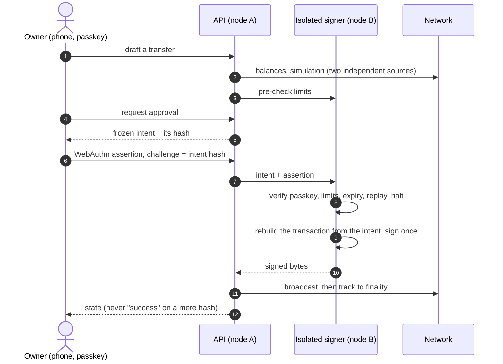
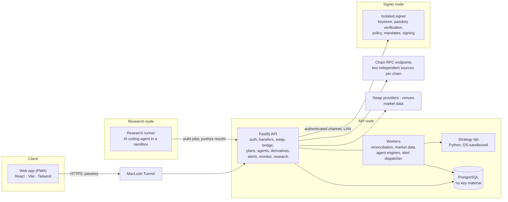

<div align="center">

# SP Wallet

**A private, single-owner, self-hosted multi-chain wallet — where no session, server or database can move funds without the owner's passkey.**

Send and receive on 23 mainnet networks, swap and bridge with signer-verified transactions, run mandate-bound trading agents, and follow everything from a phone-first PWA.

[](https://wallet.spboucher.ai)


[](https://git.spboucher.ai/sp-wallet/commits)
[](https://git.spboucher.ai/sp-wallet/commits)
[](https://git.spboucher.ai/sp-wallet/insights)
[](https://git.spboucher.ai/sp-wallet)
[](https://git.spboucher.ai/sp-wallet/insights)
[](https://git.spboucher.ai/sp-wallet)
[](https://git.spboucher.ai/sp-wallet/branches)
[](https://git.spboucher.ai/sp-wallet/tags)
[](https://git.spboucher.ai/sp-wallet)


</div>

---

> [!WARNING]
> SP Wallet moves real assets on mainnet. It is a software hot wallet on a home cluster, **not an HSM**, built for one owner and sized for small balances. No independent audit or penetration test has been performed. Read [`docs/adr/0001-custody.md`](docs/adr/0001-custody.md) and [`docs/threat-model/threat-model.md`](docs/threat-model/threat-model.md) before relying on it or raising any limit. This repository is not an invitation to use the hosted instance: it has exactly one user.

> **V11 (2026-11-17).** This page describes the wallet as of V10. V11 adds a multi-venue markets explorer and comparator
> (Hyperliquid, GMX, dYdX, edgeX read-only), private-company synthetic markets, a unified order engine with an independent
> risk engine and a global kill switch, trading mandates, a scoped trading API with Python and TypeScript SDKs, a persistent
> agents runtime, a real-time quote stream, and a market-making engine (off by default).
> Start with [`docs/V11-OVERVIEW.md`](docs/V11-OVERVIEW.md), then [`docs/V11-ARCHITECTURE.md`](docs/V11-ARCHITECTURE.md),
> [`docs/V11-DEPLOYMENT.md`](docs/V11-DEPLOYMENT.md) and [`docs/V11-REMAINING-LIMITATIONS.md`](docs/V11-REMAINING-LIMITATIONS.md).

## Contents

- [Overview](#overview)
- [What it does](#what-it-does)
- [How a transfer is authorized](#how-a-transfer-is-authorized)
- [Architecture](#architecture)
- [Trust zones](#trust-zones)
- [Networks and assets](#networks-and-assets)
- [Swaps, bridges and plans](#swaps-bridges-and-plans)
- [Trading agents](#trading-agents)
- [Derivatives](#derivatives)
- [Research laboratory](#research-laboratory)
- [Alerts and monitoring](#alerts-and-monitoring)
- [Web app](#web-app)
- [Tech stack](#tech-stack)
- [Repository layout](#repository-layout)
- [Getting started](#getting-started)
- [Configuration](#configuration)
- [API](#api)
- [Data model](#data-model)
- [Tests and quality](#tests-and-quality)
- [Deployment](#deployment)
- [Signer CLI](#signer-cli)
- [Security](#security)
- [Documentation map](#documentation-map)
- [Status and known limits](#status-and-known-limits)
- [Author and license](#author-and-license)

## Overview

SP Wallet is a wallet for exactly one person, hosted on the owner's own machines (the MacLustr cluster) and reachable at `wallet.spboucher.ai`.

- **Access:** one owner, passkey only (WebAuthn, user verification required). No password, no signup, no recovery by e-mail.
- **Custody:** keys live in an isolated signer process on a machine of its own. The API never sees a key.
- **Approval:** every owner signature is a passkey assertion over the hash of the exact operation, verified by the signer itself.
- **UI:** phone-first installable PWA, French and English, dark and light.

The project grew in ten releases, each documented under `docs/`: wallet (V1), universal swap router (V2), trading agents (V3), derivatives (V4), agents on any registry asset (V5), alerts and derivative mandates (V6), any-to-any plans, live perp agents and autonomous research jobs (V7), OS sandboxing, tracked withdrawals and GMX (V8), and two design passes (V9, V10).

## What it does

| Area | Capability |
|---|---|
| **Wallet** | Balances, receive (QR), send, activity and address book on 23 mainnet networks; native coins plus a verified token registry |
| **Swap** | Same-network swaps on 8 EVM networks (KyberSwap) and on Solana (Jupiter), with the signer decoding and checking the router call |
| **Bridge** | Native USDC over Circle CCTP V2 between 7 EVM networks and Solana; native cross-chain swaps through THORChain |
| **Plans** | Any-to-any: a short sequence (at most three legs) of operations the wallet can already execute and verify, each approved in turn |
| **Spot agents** | Long-only strategies trading inside a vault of their own, under a mandate the signer enforces by itself |
| **Derivatives** | Perpetual futures: market data, paper terminal, venue comparison router, controlled live trading — shipped disabled |
| **Perp agents** | Approved perpetual strategies in simulation, then live on a venue account under a signer-enforced mandate |
| **Research** | Python backtesting lab, plus autonomous research jobs run by an AI coding agent inside an OS sandbox |
| **Alerts** | 58 alert kinds, in-app and Web Push, with a monitoring dashboard |
| **Security screen** | Signer status, sessions, passkeys, limits, emergency halt |

## How a transfer is authorized

```
phone (passkey) ──HTTPS──▶ API (node A) ──HMAC, LAN──▶ isolated signer (node B, holds the keys)
```



1. The API drafts a transfer, checks balances on-chain, simulates it and pre-checks the signer limits.
2. `request-approval` freezes every chain parameter (nonce / UTXOs / blockhash, fees) into an **intent**, serialized deterministically and hashed (`SPW-INTENT-v1`, SHA-256).
3. The passkey signs a WebAuthn assertion whose **challenge is that hash**.
4. The signer — a separate process on a separate machine — verifies the assertion against the passkey public key it pinned at setup, re-checks its own limits / expiry / replay cache / halt flag, **rebuilds the transaction from the intent** and signs once. There is no message-signing or arbitrary-transaction endpoint.
5. The API relays the signed bytes and tracks them to finality. A returned hash is never shown as success.

A stolen session, a compromised API node or a tampered database cannot produce a signature: none of them holds the passkey, and any changed field changes the hash. What they *can* do is listed in the threat model (mainly: show a misleading review screen).

## Architecture



Three processes, on three different machines:

| Process | Bundle | Role |
|---|---|---|
| **API** | `dist/api.mjs` + `dist/web/` | Everything the owner sees: auth, chain adapters, operation life cycles, workers, audit log; serves the web app |
| **Isolated signer** | `dist/signer.mjs` | Keystore, key derivation, passkey verification, policy and mandate enforcement, signing; a single file, never built on the signer node |
| **Research runner** | `dist/research-runner.mjs` | Pulls research jobs, runs a coding agent in an OS sandbox, hands back a strategy; holds no wallet secret |

The trust boundary that matters is **API ↔ signer**. The signer runs on a dedicated machine that runs nothing else and accepts requests only from the API node over an authenticated channel.

## Trust zones

| Zone | Runs | Can do | Cannot do |
|---|---|---|---|
| **Research** | Python lab, AI coding agent, on a research node | Read market data, write strategy code, backtest, write reports | Reach the signer, hold keys, place orders, change a mandate |
| **Engine** | Deterministic worker inside the API service | Load an **approved** strategy version, compute targets, build orders, ask the signer for a *delegated* signature | Sign anything itself, change limits, use the owner's key |
| **Signer** | Isolated machine | Hold one key per agent vault, store mandates the owner approved with a passkey, sign an order only if it fits the mandate | — |
| **Owner** | Phone, passkey | Create and fund agents, approve strategy versions and mandates, pause, revoke, withdraw | — |

Research proposes; an independent, deterministic engine executes; the signer has the last word. No LLM, and no code written by an agent, can reach the signer.

## Networks and assets

**23 mainnet networks in 14 chain families** (`packages/core/src/networks.ts`):

| Family | Networks |
|---|---|
| EVM (8) | Ethereum, Base, Arbitrum One, Polygon PoS, Optimism, BNB Smart Chain, Avalanche C-Chain, HyperEVM |
| Bitcoin-like (3) | Bitcoin, Litecoin, Dogecoin |
| Bitcoin Cash | Bitcoin Cash |
| Solana | Solana |
| Others (10) | Stellar, XRP Ledger, TRON, Aptos, Cosmos Hub, Sui, NEAR Protocol, TON, Cardano, Polkadot (Asset Hub) |

Adding a family is a documented procedure: [`docs/contributing/adding-a-chain-family.md`](docs/contributing/adding-a-chain-family.md).

**Token registry** — 84 symbols, 228 deployments on 10 networks (`packages/core/src/tokens.ts`). The file is **generated**; nothing is added by hand, because a wrong address is how funds get lost. A deployment is kept only when:

1. the issuer's own document states the address;
2. a second, independent source lists the same address;
3. the contract's own on-chain metadata matches on both RPC endpoints.

Anything else is dropped, with the reason recorded. Assets are resolved by pinned address only; the API re-checks the on-chain part at every start, and a token without a signer limit cannot be sent (default deny). See [`docs/TOKENS.md`](docs/TOKENS.md).

## Swaps, bridges and plans

Every executable operation is one the signer can verify by itself:

| Leg | Operation | What the signer verifies |
|---|---|---|
| **swap** (EVM) | KyberSwap, same network, 8 networks | Pinned router, decoded calldata: recipient is the wallet itself, exact amount, minimum output |
| **swap** (Solana) | Jupiter | Decoded transaction: programs, accounts, amounts, minimum output |
| **bridge** | Circle CCTP V2, native USDC, 7 EVM networks and Solana | Builds burn and mint itself; wallet to wallet; the mint must match the approved burn |
| **xswap** | THORChain native swap | Builds memo and transaction itself; pinned assets only |

The quote layer (`packages/swap`) holds seven provider adapters — KyberSwap, Jupiter, CCTP, THORChain, LI.FI, Maya and deBridge. An adapter being present in the code never means it is being used: `packages/swap/src/enabled.ts` applies the owner's terms-of-use decisions on top (deBridge is off unless explicitly enabled).

**Any-to-any plans** (V7) chain these legs. Native USDC is the hub — the only asset a plan rests in between two legs. A plan has at most three legs, never visits a network twice and never chains two legs of the same kind. **A plan is never a new trust path**: each leg goes through the same route the owner would use by hand, with the same signer verification, and is approved with the passkey when its turn comes. The full matrix of what is executable between which families is in [`docs/v7/ANY-TO-ANY.md`](docs/v7/ANY-TO-ANY.md).

## Trading agents

A spot agent trades inside an **agent vault**: an address of its own, funded by an ordinary passkey-approved transfer from the owner.

- A **mandate** — approved once with a passkey over its canonical hash, stored by the signer — names the vault, the network, the allowed assets, the allowed router, caps per order and per day, a maximum number of orders per day and an expiry.
- A **delegated signature** is given only to a swap whose source *and recipient are the vault itself*, between allowed assets, on the pinned router, within the caps, before expiry, while not halted or revoked.
- A transfer out of a vault is only ever signed **towards the owner's own address**.
- Revocation and emergency halt need no passkey (stopping is always safe). Raising any limit needs a new passkey approval.

Agent modes: `RESEARCH → BACKTESTING → PAPER_TRADING → AWAITING_APPROVAL → LIVE` (also `PAUSED`, `STOPPED`, `FAILED`). Paper trading uses live market data and live quotes but signs nothing. `LIVE` requires an approved strategy version **and** an active mandate.

Since V5 an agent can trade any registry asset that has market data, on every network where swap execution is enabled. Withdrawals from a vault are tracked through explicit states until the payment is seen on-chain (V8).

> What this does not guarantee: the signer cannot see prices. Inside its mandate an agent can still trade badly; the worst case is the loss of the capital placed in that vault.

Details: [`docs/v3/ARCHITECTURE.md`](docs/v3/ARCHITECTURE.md), [`docs/v5/AGENTS-ANY-ASSET.md`](docs/v5/AGENTS-ANY-ASSET.md), [`docs/v8/WITHDRAWALS.md`](docs/v8/WITHDRAWALS.md).

## Derivatives

Perpetual futures, built around four modes per venue account:

`READ_ONLY` → `PAPER` → `MANUAL_LIVE` (passkey per order) → `MANDATE_LIVE` (signer-enforced mandate)

A new account starts `READ_ONLY`. Live modes are off until the owner turns them on per venue, with a passkey.

| Venue | In this repository |
|---|---|
| **Hyperliquid** | Market data, paper terminal, manual live orders, derivative mandate, collateral moves. Ships disabled and testnet-first; mainnet is gated by server settings |
| **GMX v2** | Market data and trading built in V8; off by default behind its own server setting |
| **dYdX** | Market data, used for comparison |

- The **universal derivatives router** answers one question — what would this order look like on each venue? — and executes nothing. It refuses stale data.
- On a venue with trading keys, the main wallet key never trades: a dedicated *trading key*, which can place and cancel orders but cannot withdraw, is authorized once by the owner and can be revoked.
- A deterministic **risk policy engine** sits between every order proposal and the signer.
- **Perp agents** (V7) start in simulation and go live only after the owner authorized a venue account and approved a mandate.

Details: [`docs/v4/DERIVATIVES-ARCHITECTURE.md`](docs/v4/DERIVATIVES-ARCHITECTURE.md), [`docs/v4/ROUTER.md`](docs/v4/ROUTER.md), [`docs/v6/DERIVATIVE-MANDATE.md`](docs/v6/DERIVATIVE-MANDATE.md), [`docs/v7/PERP-AGENT-LIVE.md`](docs/v7/PERP-AGENT-LIVE.md), venue notes under [`docs/v4/venues/`](docs/v4/venues/) (including a jurisdiction note — general information, not legal advice).

## Research laboratory

`research/` is **spq**, a Python 3.12 laboratory managed with `uv`. It proposes; it never executes.

- **Strategy contract**: a strategy version is a directory with one `strategy.py`; its identity is the SHA-256 of that file. It exposes `META` and a pure `target_weights(data, params)` — no network, no clock, no files.
- **Backtester**: event-driven, decision on the closed bar, fill at the next bar's open, with fees and slippage, and benchmarks.
- **Robustness**: chronological splits, walk-forward, block bootstrap, parameter sensitivity, deflated Sharpe ratio, look-ahead check.
- **Library**: 16 strategies, spot and perpetual (trend, momentum, mean reversion, breakout, pairs, funding carry, volatility).
- A report never says a strategy is profitable; it reports what was measured, on which data, with which costs.

**Autonomous research jobs** (V7): the owner writes a mission in plain language; an AI coding agent works on it on a research node, inside an OS sandbox, and hands in a strategy with its notes. The wallet's server then re-does everything itself — hash, purity check, backtest on data the agent never had — and leaves a draft for the owner to approve.

**Sandboxing** (V8): every process that runs strategy code is one Python interpreter inside a deny-default OS sandbox profile — no network, no fork, other processes invisible. If the sandbox is unavailable, no signal and no backtest runs, and agents hold.

Details: [`research/README.md`](research/README.md), [`docs/v7/RESEARCH-RUNTIME.md`](docs/v7/RESEARCH-RUNTIME.md), [`docs/v8/SANDBOX.md`](docs/v8/SANDBOX.md), [`services/research-runner/README.md`](services/research-runner/README.md).

## Alerts and monitoring

The owner is told, on the phone and in the app, when something important happens. The alerts layer only **reads** what the system already records; nothing in signing, policy, limits or money logic depends on it.

- One dispatcher tails the append-only event tables by id. One pass is one database transaction, so an event becomes an alert **exactly once**.
- 58 alert kinds in five groups (transfers, agents, derivatives, security, system), with French and English wording kept in one catalogue shared by the API, the web app and the service worker.
- Channels: in-app, Web Push, optional webhook. A lock-screen wording without amounts, prices or addresses is used when details are switched off.
- A **system status** dashboard shows worker heartbeats, the capabilities that are on or off, and the strategy sandbox state.

Details: [`docs/v6/ALERTS.md`](docs/v6/ALERTS.md).

## Web app

`apps/web` is a Vite + React single-page app served by the API (no inline script, so the content security policy can stay strict).

Screens: Home, Assets, Asset, Receive, Send, Activity, Swap (with bridges and plans), Agents, Agent funding, Agent paper view, Perp agent, Perp agent live, Futures (paper terminal, live accounts, GMX, comparison), Alerts, System status, Research, Security, Settings — plus the lock screen.

Design principles, from [`docs/v9/DESIGN.md`](docs/v9/DESIGN.md):

1. **Calm, confident, premium.** One hero per screen, generous numerals, quiet chrome.
2. **Honest before handsome.** A review shows every field in full; nothing is truncated on an approval; no figure about to be approved is animated; simulation, testnet and real stay unmistakable.
3. **Depth by layering, not by paint.**
4. **Colour never carries a meaning alone.**

Before/after pictures of both design passes: [`docs/v9/SHOWCASE.md`](docs/v9/SHOWCASE.md), [`docs/v10/SHOWCASE.md`](docs/v10/SHOWCASE.md).

## Tech stack

| Role | Technology | Version |
|---|---|---|
| Language | TypeScript (native type stripping) | 7.0.2 |
| Runtime | Node.js | ≥ 24 |
| API server | Fastify (+ cookie, rate-limit, static) | 5.12.8 |
| Database | PostgreSQL through postgres.js | 4.1.0 |
| Validation | Zod | 4.6.7 |
| Passkeys | SimpleWebAuthn (server / browser) | 14.1.0 / 14.0.0 |
| EVM | viem | 2.57.17 |
| Cryptography | @noble/curves, @noble/hashes, @scure/base, @scure/bip32, @scure/bip39 | 2.4.0 |
| Bitcoin-like | @scure/btc-signer | 2.4.1 |
| Web app | React / React DOM | 19.3.1 |
| Bundler (web) | Vite | 8.3.7 |
| Styles | Tailwind CSS | 4.3.5 |
| Data fetching | TanStack Query | 5.107.1 |
| QR codes | qrcode | 1.5.4 |
| Bundler (services) | esbuild | 0.28.2 |
| Unit and integration tests | Vitest, fast-check | 5.1.0 / 4.10.2 |
| End-to-end tests | Playwright | 1.65.0 |
| Research lab | Python, pandas, NumPy, SciPy, statsmodels, scikit-learn, arch | 3.12 / 3.1.1 / 2.5.4 / 1.18.1 / 0.15.0 / 1.9.1 / 8.0.0 |
| Package manager | pnpm (exact versions, `save-exact`) | 11.1.2 |

Chain SDKs appear only as development dependencies: they are used by tests to cross-check the wallet's own transaction builders against an independent implementation.

## Repository layout

| Path | Role |
|---|---|
| `packages/core` | Network and asset registry, exact amounts, address validation, canonical intent + hash, transaction builders, chain-family plugins, policy, mandates, swap verification, audit hash chain, state machine, alert catalogue |
| `packages/swap` | Universal swap router: provider adapters, route graph, aggregator, risk scoring, any-to-any planner |
| `packages/derivatives` | Venue models, margin, paper engine, risk policy, comparison router, live canonical forms and mandates |
| `services/isolated-signer` | Keystore (scrypt + AES-256-GCM), key derivation, passkey verification, policy and mandate enforcement, signing; CLI |
| `services/api` | Fastify API: passkey auth, sessions, chain adapters with dual-RPC checks, transfer / swap / bridge / plan life cycles, agents, derivatives, market data, alerts, monitor, research, workers, audit log; serves the web app |
| `services/research-runner` | Standalone service for a research node: runs research jobs in an OS sandbox |
| `apps/web` | Vite + React + Tailwind PWA |
| `research/` | Python lab `spq`: strategies, backtests, signals, schemas, results; token-registry evidence |
| `tests/` | Software passkey helper, Playwright end-to-end specs |
| `scripts/` | Build, dev stack, preflight, backup, and smoke / simulation / fork scripts |
| `infra/launchd` | Service definition for the signer relay |
| `docs/` | Custody ADR, threat model, runbooks, per-release architecture notes, provider and venue notes, design system |

## Getting started

Requirements: Node.js ≥ 24, pnpm 11, a local PostgreSQL, and `uv` for the research lab.

```bash
pnpm install
pnpm typecheck
pnpm test            # unit / integration / security tests (needs a local PostgreSQL)
pnpm build           # dist/api.mjs, dist/signer.mjs, dist/research-runner.mjs, dist/web/
scripts/dev-stack.sh # local stack on http://localhost:8650, throwaway keys, broadcast OFF
pnpm e2e             # Playwright, phone viewport, virtual passkey (run dev-stack.sh first)
scripts/dev-stop.sh
```

The development stack creates a **throwaway** signer keystore and never relays a signed transaction to a network (`SPW_BROADCAST=off`).

Research lab:

```bash
cd research
uv sync
uv run pytest
uv run python -m spq.backtest --strategy strategies/ma_trend/1 --symbols ETH,LINK --interval 1h \
    --start 2024-11-10 --end 2026-11-10 --fee-bps 10 --slippage-bps 10 --data-dir data --out report.json
```

## Configuration

No secret is stored in this repository: `.env*`, data directories and signer data are ignored by git. Variables are documented here by **name and role only**.

### API

| Variable | Role | Default |
|---|---|---|
| `SPW_ORIGIN` | Public origin of the app; passkeys are bound to it | — (required) |
| `SPW_RP_ID` | WebAuthn relying-party id | — (required) |
| `DATABASE_URL` | PostgreSQL connection | — (required) |
| `SPW_SIGNER_SECRET` | Shared secret authenticating the API ↔ signer channel | — (required) |
| `SPW_SIGNER_URL` | Where the API reaches the signer | local address |
| `PORT` / `HOST` | Listening port and interface | `8650` / `127.0.0.1` |
| `SPW_TRUST_PROXY` | Proxies whose forwarded headers are trusted | `127.0.0.1` |
| `SPW_WEB_DIR` | Directory of the built web app to serve | — |
| `SPW_BROADCAST` | `off` ⇒ signed bytes are never relayed to a network (tests, development) | `on` |
| `SPW_WORKERS` | `off` ⇒ background workers do not start | `on` |
| `SPW_SWAP_ENABLE` / `SPW_SWAP_DISABLE` | Turn swap provider adapters on or off, by id | — |
| `LIFI_API_KEY` | Optional key lifting the keyless LI.FI rate limit | — |
| `SPW_DERIV_LIVE_MAINNET` | Allows mainnet derivative orders and collateral moves | off |
| `SPW_DERIV_MANDATE_MAINNET` | Allows mandate-driven (autonomous) derivative trading on mainnet | off |
| `SPW_DERIV_GMX_LIVE` | Opens GMX trading | off |
| `RESEARCH_DATABASE_URL` | Read-only database role used to read backtest candles | — |
| `SPW_RESEARCH_RUNNER_SECRET` | Shared secret of the research runner; without it its routes answer 404 | — |
| `SPW_LAB_SANDBOX` | `off` ⇒ strategy code runs without OS confinement (development only) | enforced |

At start-up the API prints which capabilities are on and, for each one that is off, the **name** of the missing variable — never a value.

### Signer

| Variable | Role |
|---|---|
| `SPW_SIGNER_DIR` | Signer data directory (keystore, state, policy) |
| `SPW_SIGNER_WRAP_KEY` | Location of the key that wraps the keystore |
| `SPW_SIGNER_PORT` | Listening port |
| `SPW_SIGNER_ALLOW_IPS` | Source addresses allowed to reach the signer |
| `SPW_SIGNER_SECRET` | Same shared secret as the API |
| `SPW_ORIGIN`, `SPW_RP_ID` | Origin and relying-party id checked in every assertion |

### Research runner

Variables prefixed `SPW_RUNNER_` (API URL, runner id and secret, laboratory checkout, agent command, sandbox switch, polling). The runner **refuses to start** if a database URL, a signer variable or the wallet's origin is present in its environment. See [`services/research-runner/README.md`](services/research-runner/README.md).

## API

185 routes under `/api/v1`, registered across 20 modules. Only the health probe and the authentication bootstrap are public; everything else requires a session, and anything that moves value additionally requires a passkey assertion verified by the signer.

| Module | Routes | Prefix |
|---|---:|---|
| `server.ts` | 18 | `health`, `networks`, `assets`, `accounts`, `portfolio`, `activity`, `addressbook`, `settings`, `security`, `export` |
| `auth.ts` | 10 | `auth` — passkey setup, login, sessions |
| `transfers.ts` | 6 | `transfers` — draft, approval, tracking |
| `swap.ts`, `swap-exec.ts` | 7 | `swap` — quotes and execution |
| `bridge.ts`, `bridge-sol.ts` | 11 | `bridge` — CCTP, EVM and Solana sides |
| `xswap.ts` | 3 | `xswap` — native cross-chain swaps |
| `plan-exec.ts` | 9 | `plans` — any-to-any plans |
| `agents/routes.ts`, `agents/strategies.ts` | 16 | `agents`, `strategies` — spot agents |
| `agents/perp-routes.ts` | 9 | `agents` — perp agents |
| `derivatives/routes.ts` | 20 | `derivatives` — data, paper, router |
| `derivatives/live-routes.ts` | 28 | `derivatives/live` — venue accounts, orders, mandates |
| `derivatives/collateral-routes.ts` | 7 | `derivatives/live/accounts/:id/collateral` |
| `derivatives/gmx-routes.ts` | 12 | `derivatives/gmx` |
| `market/routes.ts` | 2 | `market-data` |
| `alerts/routes.ts` | 13 | `alerts` — rules, subscriptions, history |
| `monitor/routes.ts` | 4 | `monitor` — system status |
| `research/routes.ts` | 10 | `research` — jobs, runner hand-off |

Health: `GET /api/v1/health/live` (public, no detail) and `GET /api/v1/health/ready` (database, signer, networks).

Route-level notes for the derivative area: [`docs/v4/API-LIVE-NOTES.md`](docs/v4/API-LIVE-NOTES.md), [`docs/v4/API-WAVE2-NOTES.md`](docs/v4/API-WAVE2-NOTES.md).

## Data model

42 PostgreSQL tables, created and migrated by the API at start-up (`services/api/src/db.ts`; additive and idempotent). **The database holds no key material.**

| Group | Tables |
|---|---|
| Access | `credentials`, `pending_credentials`, `challenges`, `sessions`, `settings` |
| Wallet | `proposals`, `deposits`, `scan_cursor`, `address_book`, `audit_events` |
| Swaps and plans | `swap_quotes`, `plans` |
| Spot agents | `agents`, `agent_orders`, `agent_paper`, `agent_equity`, `agent_withdrawals`, `strategy_versions` |
| Derivatives | `deriv_accounts`, `deriv_paper_accounts`, `deriv_orders`, `deriv_fills`, `deriv_funding`, `deriv_actions`, `deriv_collateral`, `deriv_equity`, `deriv_gmx_ops`, `deriv_mandates`, `deriv_risk_events` |
| Perp agents | `perp_agent_signals`, `perp_candles`, `perp_funding` |
| Market data | `candles`, `market_quality` |
| Research | `research_jobs`, `research_job_log`, `research_log` |
| Alerts | `alerts`, `alert_cursors`, `alert_seen`, `alert_state`, `push_subscriptions` |

`audit_events` is an append-only hash chain. The signer keeps its own journal, also hash-chained, on its own machine.

## Tests and quality

```bash
pnpm typecheck                     # every package, service and the web app
pnpm test                          # Vitest
pnpm e2e                           # Playwright (after scripts/dev-stack.sh)
(cd research && uv run pytest)     # Python lab
```

| Suite | Files | Tests |
|---|---:|---:|
| `packages/core` | 19 | 273 |
| `packages/swap` | 9 | 210 |
| `packages/derivatives` | 19 | 321 |
| `services/api` | 41 | 595 |
| `services/isolated-signer` | 22 | 197 |
| `services/research-runner` | 3 | 36 |
| `apps/web` | 10 | 121 |
| **Vitest total** | **123** | **1,753** |
| Playwright (`tests/e2e`) | 15 | 55 |
| pytest (`research/tests`) | 21 | 187 |

Counts are test declarations found in the source; parameterized and property-based tests run more cases than that.

What the tests are for:

- **Security properties** — a session alone cannot move funds; a tampered stored intent is refused; replayed approvals are refused; a wrong origin is refused; token impersonation is refused.
- **Builders** — transaction builders are cross-checked against independent SDK decoders and public test vectors.
- **Concurrency** — database tests each get a database of their own, dropped when the run ends.
- **End to end** — phone viewport, virtual passkey, real local stack with throwaway keys and broadcast off.

Beyond the test suites, `scripts/` holds 45 smoke, simulation and fork scripts (`smoke-*.mts` read live networks; `sim-*.mts` and `fork-*.mts` exercise flows against simulations and local forks), and `scripts/preflight.sh`, a read-only pre-deployment check that prints `ok` / `WARN` / `FAIL` lines and never a secret.

## Deployment

SP Wallet runs on the MacLustr cluster as PM2 processes, placed by the `mld` orchestrator and exposed through the MacLustr Tunnel.

| | |
|---|---|
| Public URL | <https://wallet.spboucher.ai> |
| API + web | node `M2M32c`, directory `~/apps/sp-wallet`, PM2 `sp-wallet`, port `8650` |
| Signer | PM2 `sp-wallet-signer`, on a dedicated node that runs nothing else, reachable from the API node only |
| Database | PostgreSQL on the API node; nightly dump (no key material) |
| Health | `GET /api/v1/health/live` |

Release recipe, in short (the full, authoritative version is [`docs/runbooks/deploy.md`](docs/runbooks/deploy.md)):

1. **Preflight** on the API node: `scripts/preflight.sh`.
2. **Build on the node**: `pnpm install --frozen-lockfile && pnpm typecheck && pnpm build`, then `uv sync --frozen` in `research/`.
3. **Back up** the database before a release that changes the schema: `scripts/backup.sh`.
4. **Restart** the API and read the start-up capability lines.
5. **Signer** — only when the signer or `packages/core` changed: the signer is deployed as **one file**, copied to its node, never built there; its data directory is never touched by a deployment. Afterwards, check in the app that the signer answers and that **its key id is unchanged**.
6. **Research node** — only when the runner or the lab changed.

Rollback is a checkout of the previous commit, a rebuild and a restart: schema changes are additive, so the previous code runs on the newer schema.

Day-to-day operations — emergency halt, recovery-phrase backup, restore, lost passkey, changing limits, suspected compromise — are in [`docs/runbooks/operations.md`](docs/runbooks/operations.md).

## Signer CLI

Run on the signer machine:

```bash
node signer.mjs status           # key id, addresses, limits, journal integrity (no secrets)
node signer.mjs export-recovery  # interactive terminal only: prints the recovery phrase once, for paper backup
node signer.mjs halt | unhalt    # emergency stop / resume (then restart the signer process)
node signer.mjs reset-passkeys && node signer.mjs setup-token   # lost passkey: re-run owner setup
```

Limits live in a `policy.json` file in the signer's data directory, on the signer machine only (bump `version` when editing, then restart). Resuming after a halt is possible from the signer CLI only: a compromised app must not be able to resume signing.

## Security

The design, in general terms:

| Layer | Control |
|---|---|
| **Custody** | Keys exist only on the isolated signer, in an encrypted keystore; the API and the database never hold key material |
| **Approval** | Every owner signature needs a fresh passkey assertion, with user verification, whose challenge is the hash of the exact operation |
| **Independent verification** | The signer pins the passkey public key at setup and verifies assertions, origin and relying party itself — it does not trust the API |
| **Narrow signing surface** | The signer rebuilds each transaction from the intent and can only express a fixed set of operation shapes; no message signing, no arbitrary transaction |
| **Limits** | Signer-side caps per transfer and per day, fee ceilings, a short approval window, single-use proposals, replay cache |
| **Emergency halt** | Stops all signing; can be triggered from the app, lifted from the signer CLI only |
| **Delegation** | Agents sign only under a mandate stored and enforced by the signer; raising a limit needs a new passkey approval |
| **Chain data** | Two independent endpoints per chain must agree for anything that feeds a signature; chain identity and token metadata verified on-chain; fail closed |
| **Assets** | Resolved by pinned address from a generated, evidence-backed registry; default deny |
| **Sessions** | `__Host-` cookie, HttpOnly, Secure, SameSite=Strict, idle and absolute expiry; a session cannot sign |
| **Web** | Strict content security policy, no inline or third-party script, HSTS |
| **Finality** | An operation is reported final only at chain finality; reorgs are a tracked state |
| **Audit** | Append-only hash-chained audit log in the database; separate hash-chained journal on the signer |
| **Supply chain** | Exact pinned versions and a lockfile; a small dependency set; the signer has its own bundle |
| **Untrusted code** | Strategy code runs only inside a deny-default OS sandbox with no network and no fork |

The **accepted residual risks** — what a compromised API node, a compromised signer node, a misleading review screen, or the loss of the recovery phrase would mean — are stated plainly in the [custody ADR](docs/adr/0001-custody.md) and the [threat model](docs/threat-model/threat-model.md). Deviations from the original specification, and why, are in [`docs/security/acceptance.md`](docs/security/acceptance.md).

Found a security problem? Write privately to **contact@spboucher.ai** — please do not open a public issue.

## Documentation map

| Topic | Document |
|---|---|
| Custody decision | [`docs/adr/0001-custody.md`](docs/adr/0001-custody.md) |
| Threat model | [`docs/threat-model/threat-model.md`](docs/threat-model/threat-model.md) |
| Deviations from the specification | [`docs/security/acceptance.md`](docs/security/acceptance.md) |
| Deploying a release | [`docs/runbooks/deploy.md`](docs/runbooks/deploy.md) |
| Operations | [`docs/runbooks/operations.md`](docs/runbooks/operations.md) |
| Token registry | [`docs/TOKENS.md`](docs/TOKENS.md) |
| Adding a chain family | [`docs/contributing/adding-a-chain-family.md`](docs/contributing/adding-a-chain-family.md) |
| Chain notes | [`docs/chains/cardano.md`](docs/chains/cardano.md), [`docs/chains/polkadot.md`](docs/chains/polkadot.md) |
| Swap router status (V2) | [`docs/V2-IMPLEMENTATION-STATUS.md`](docs/V2-IMPLEMENTATION-STATUS.md) |
| Swap providers | [`docs/swap/providers/`](docs/swap/providers/), [`docs/swap/adding-a-provider.md`](docs/swap/adding-a-provider.md) |
| Trading agents (V3, V5) | [`docs/v3/ARCHITECTURE.md`](docs/v3/ARCHITECTURE.md), [`docs/v5/AGENTS-ANY-ASSET.md`](docs/v5/AGENTS-ANY-ASSET.md) |
| Derivatives (V4) | [`docs/v4/DERIVATIVES-ARCHITECTURE.md`](docs/v4/DERIVATIVES-ARCHITECTURE.md), [`docs/v4/ROUTER.md`](docs/v4/ROUTER.md), [`docs/v4/quant-perps.md`](docs/v4/quant-perps.md), [`docs/v4/venues/`](docs/v4/venues/) |
| Alerts, derivative mandate (V6) | [`docs/v6/ALERTS.md`](docs/v6/ALERTS.md), [`docs/v6/DERIVATIVE-MANDATE.md`](docs/v6/DERIVATIVE-MANDATE.md) |
| Plans, live perp agents, research runtime (V7) | [`docs/v7/ANY-TO-ANY.md`](docs/v7/ANY-TO-ANY.md), [`docs/v7/PERP-AGENT-LIVE.md`](docs/v7/PERP-AGENT-LIVE.md), [`docs/v7/RESEARCH-RUNTIME.md`](docs/v7/RESEARCH-RUNTIME.md) |
| Sandbox, withdrawals (V8) | [`docs/v8/SANDBOX.md`](docs/v8/SANDBOX.md), [`docs/v8/WITHDRAWALS.md`](docs/v8/WITHDRAWALS.md) |
| Design system and showcases (V9, V10) | [`docs/v9/DESIGN.md`](docs/v9/DESIGN.md), [`docs/v9/SHOWCASE.md`](docs/v9/SHOWCASE.md), [`docs/v10/SHOWCASE.md`](docs/v10/SHOWCASE.md) |

## Status and known limits

The `main` branch is at the V10 design pass. The repository's own documents record what is verified and what is not; the main limits they state:

- **Small balances only.** The custody model was accepted by the owner for small amounts; move to a hardware-backed model before holding more.
- **No independent audit**, penetration test or third-party review of the custody boundary.
- **The review screen is rendered by the web app**: the passkey prompt does not display transaction details. Loss is bounded by the signer limits.
- **Live derivative trading ships disabled** and testnet-first; each mainnet capability needs an explicit server setting.
- **Send and receive only** on the networks that have no executable swap leg (see the plan matrix).
- **No full Bitcoin node**: public indexers are used, two of which must agree.

## Author and license

**Simon-Pierre Boucher** — [contact@spboucher.ai](mailto:contact@spboucher.ai)

All rights reserved. The source is published for reading; no license to use, copy or redistribute it is granted.

Nothing in this repository is financial, investment or legal advice.
