# SP Wallet — design pass 2 (v10): showcase

The first pass (`docs/v9/SHOWCASE.md`) redesigned the shell, Home, Assets, Asset, Receive, Send, Activity, the lock
screen, Settings and Security. This pass brings every remaining screen to the same system (`docs/v9/DESIGN.md`):
Swap, bridges and plans; agents (spot and perpetual); the Futures area (paper terminal, live accounts, GMX); Alerts,
System status and Research. It also finishes what the first pass left: the large title collapses into the header, every
sheet is the shared `Sheet`, and Home / Assets load and scroll faster than before the redesign.

Pictures: `docs/v10/screens/before/` and `docs/v10/screens/after/`, named `<area>-<screen>-<phone|desktop>-<light|dark>.webp`
(phone 390 × 844 @3x, desktop 1440 × 900, French). They were taken by `tests/e2e/v10-shots-<area>.mts` against the real
local QA stack (throwaway in-memory seed, broadcast off, local forks) and the development mocks — never a real key, never a
real transaction. Each area's pictures were taken on that area's branch before the five were merged; the merged result is
what `tests/e2e/v10-visual.spec.ts` records.

## What the system gained (apps/web/src/ui.tsx, styles.css)

| Piece | Use |
|---|---|
| `Sheet` — `sub`, `footer`, `busy`, `testid`, keyboard-safe | every bottom sheet: grabber, drag down to dismiss, spring, lifted above the on-screen keyboard, always above the tab bar; approval sheets are not dismissable and nothing closes a sheet while its request is in flight |
| `Tag`, `Stat` / `StatGrid`, `Fact`, `Section` | state as icon + word; figures in quiet tiles; receipt rows whose value is never cut |
| `Timeline` | legs of a plan, steps of a bridge or of a collateral move: done / current / next / failed, icon + word |
| `ProgressRing` | "n / 4" of a checklist, the count written in the ring |
| `Fold` | secondary data only (comparison-only routes, technical detail) — never a fee, a minimum or a warning |
| `ErrorState`, `SkeletonCard`, `SkeletonStats` | designed error / offline states, skeletons shaped like the final layout |
| large-title collapse | the page title takes the brand's place in the header once it has scrolled under it |

## Phone, light

| Screen | Before | After |
|---|---|---|
| Swap with quotes |  | 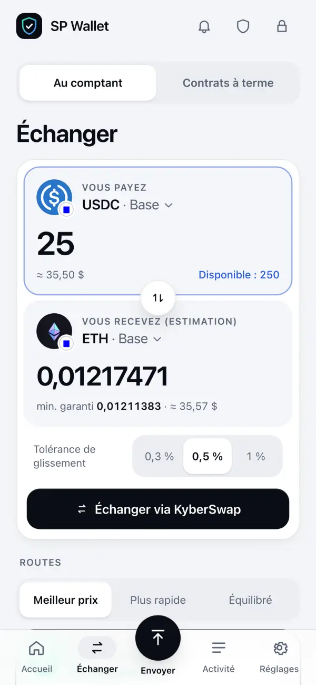 |
| Swap — review (what the passkey signs) |  | 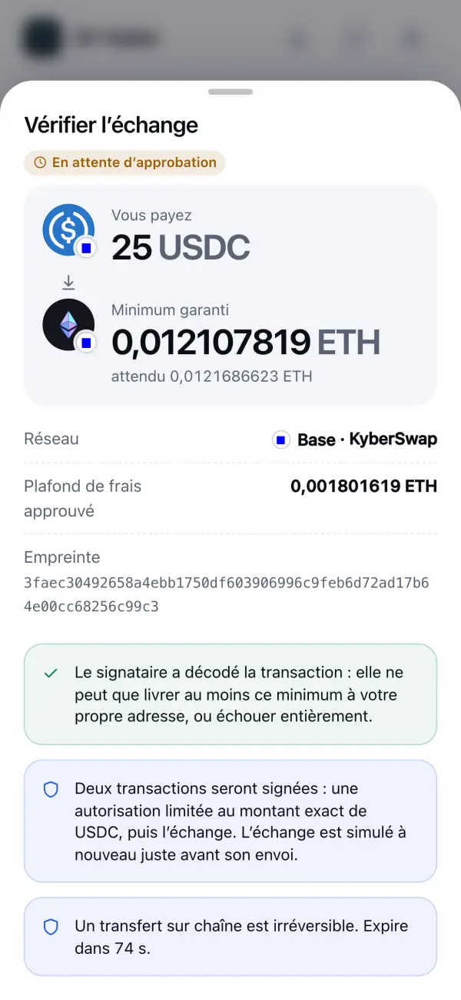 |
| Bridge (USDC, Circle CCTP) |  | 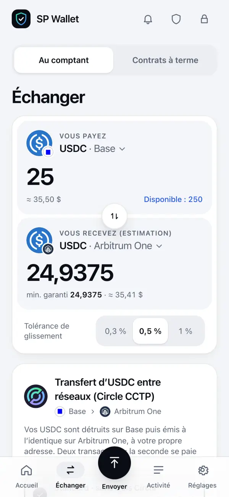 |
| Plan in progress |  | 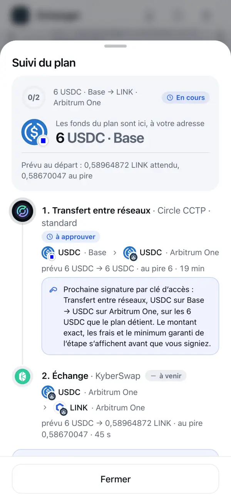 |
| Agents |  | 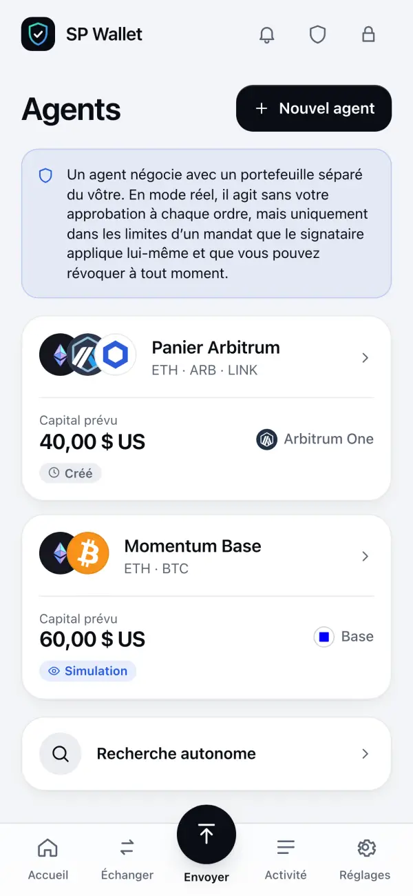 |
| Agent page |  | 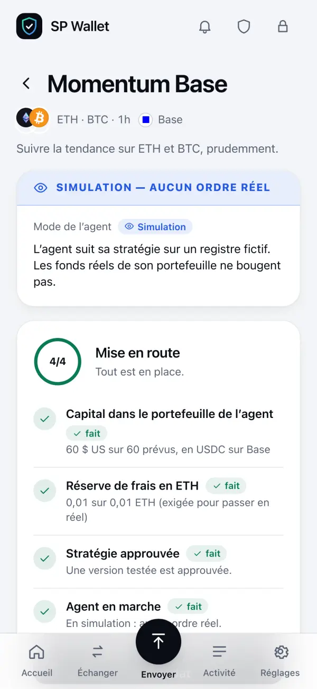 |
| Fund an agent |  | 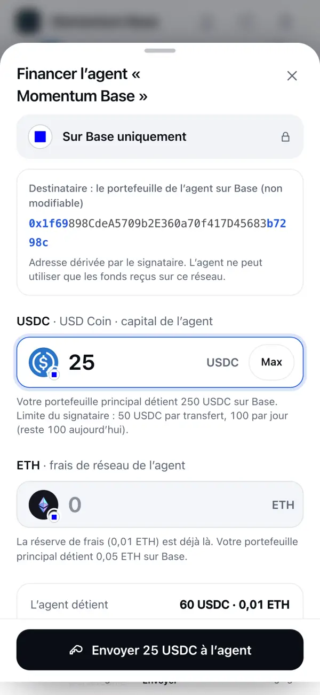 |
| Withdrawal, tracked |  | 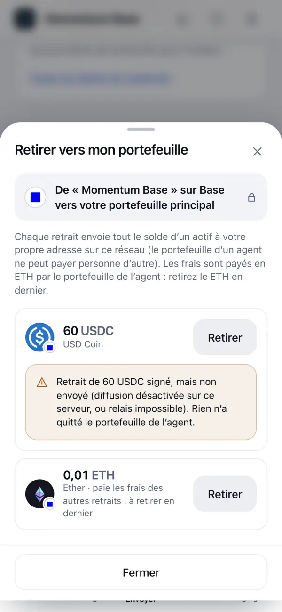 |
| Perp agent, live |  | 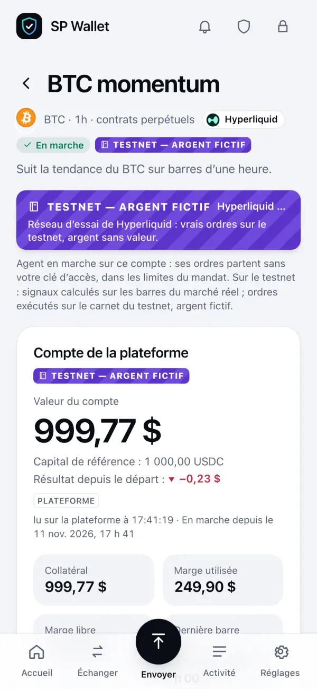 |
| Futures terminal — chart |  | 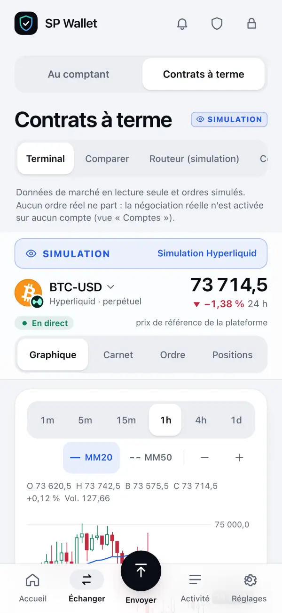 |
| Futures terminal — book |  | 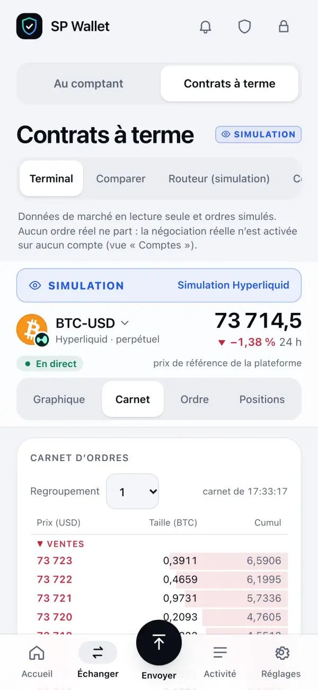 |
| Futures — order with preview |  | 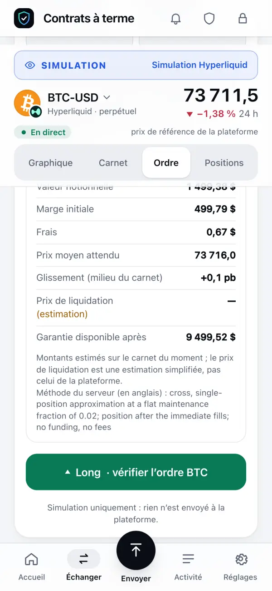 |
| Band: RÉEL — argent réel |  | 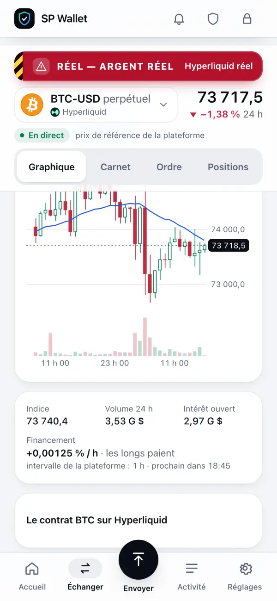 |
| Band: TESTNET — argent fictif |  | 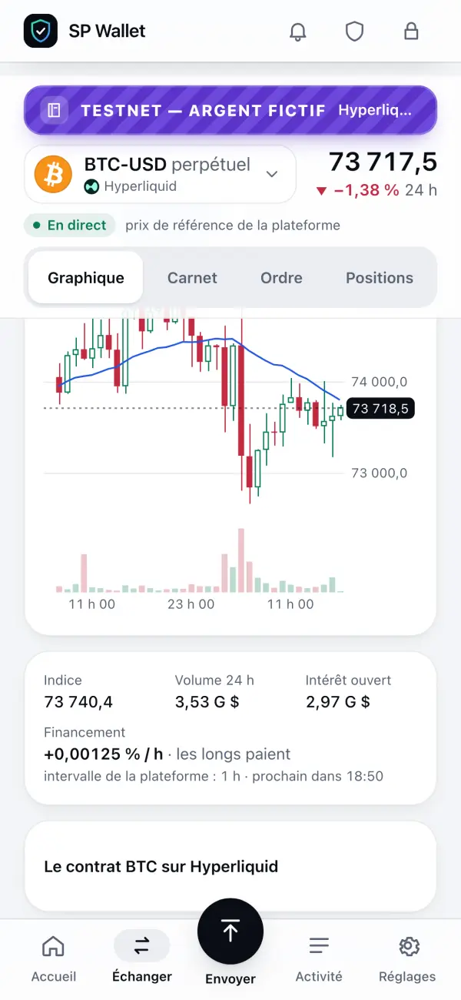 |
| Live order approval, real money |  | 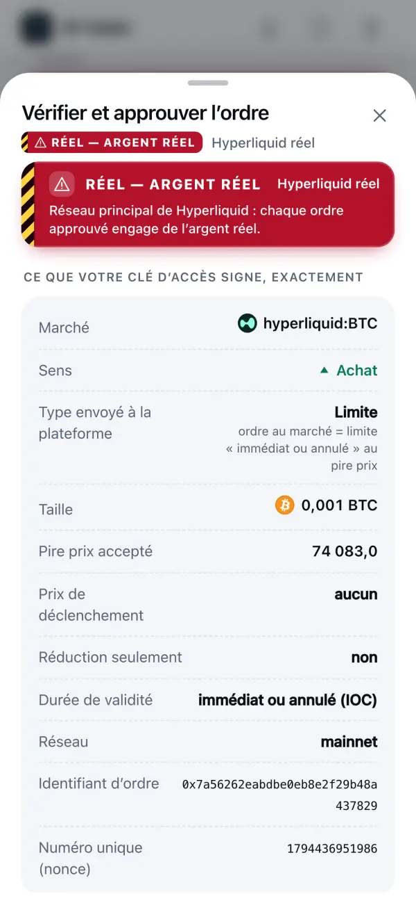 |
| Collateral deposit in progress |  | 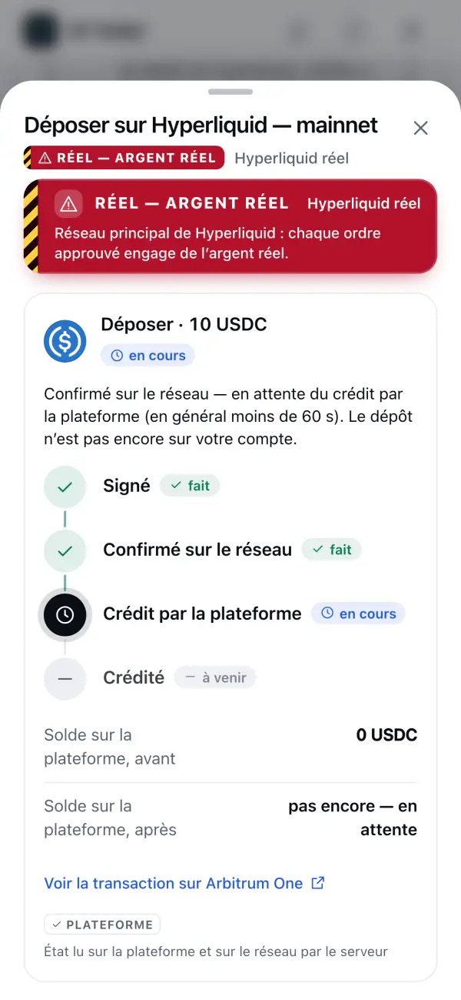 |
| GMX activity |  | 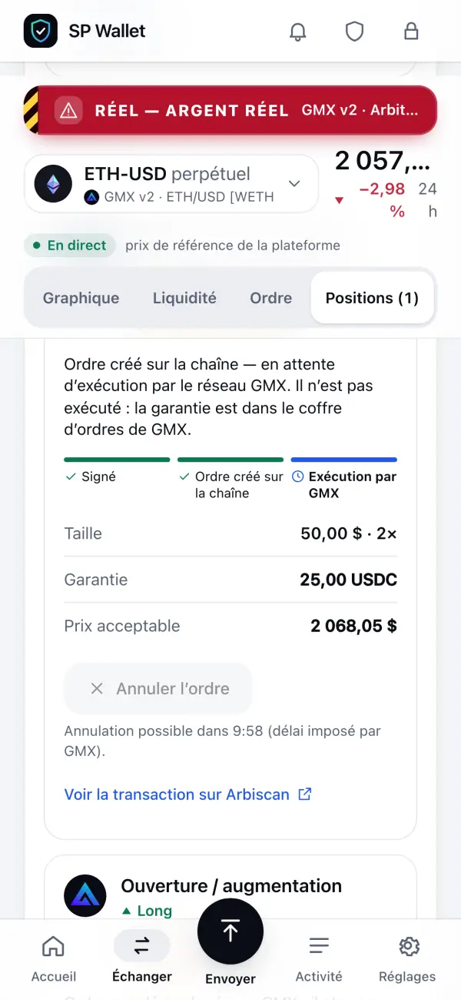 |
| Alerts |  | 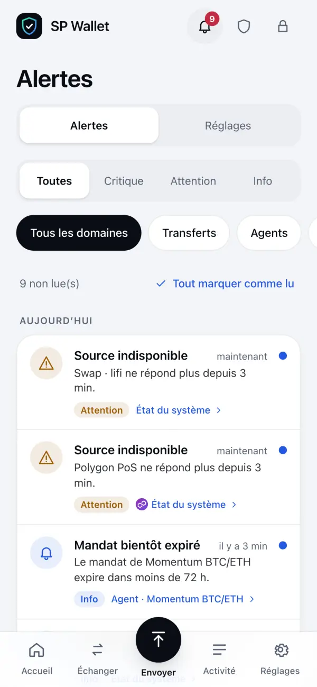 |
| Alerts — settings |  | 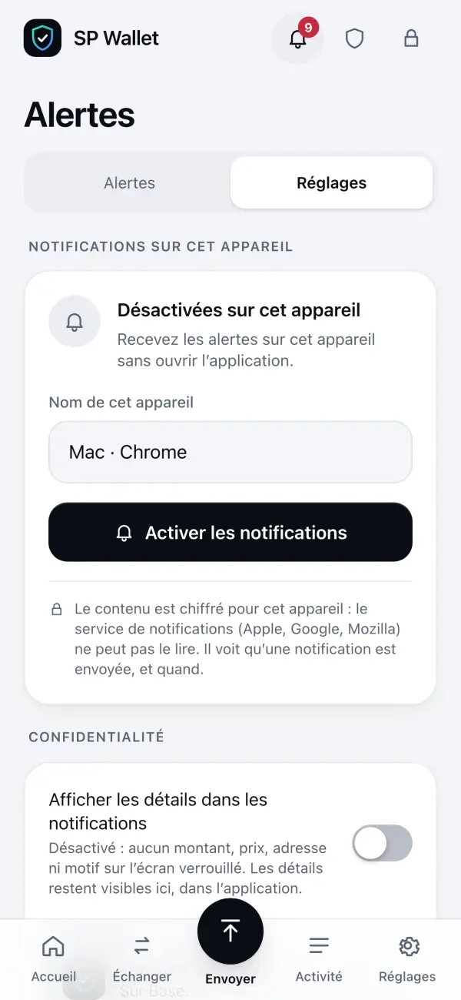 |
| System status, all well |  | 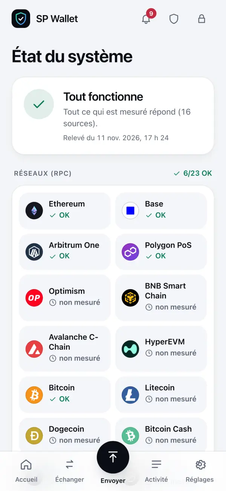 |
| Research — the agent's numbers differ |  | 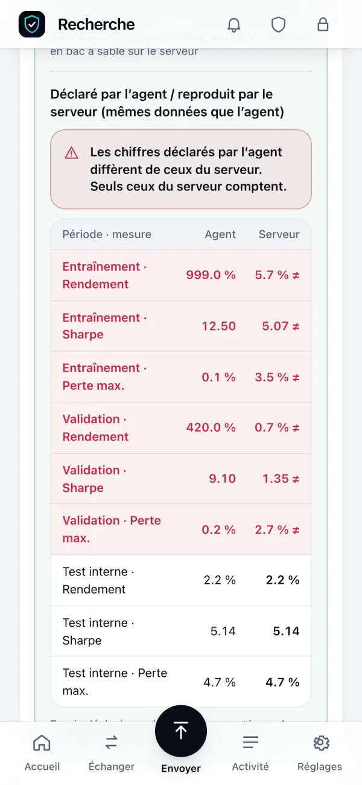 |

## Phone, dark

| Screen | Before | After |
|---|---|---|
| Swap with quotes |  |  |
| Agent page |  |  |
| Futures terminal — chart |  |  |
| Live order approval, real money |  |  |
| Alerts |  |  |
| System status, something to check |  |  |
| Research — a job |  |  |

## Desktop

| Screen | Before | After |
|---|---|---|
| Swap with quotes, light |  |  |
| Agent page, dark |  |  |
| Futures terminal, dark |  |  |
| Futures — router, light |  |  |
| Live accounts, light |  |  |
| Alerts, light |  |  |
| System status, dark |  |  |

## The shell

| Large title collapsed (Assets) | Large title collapsed (Security) |
|---|---|
| 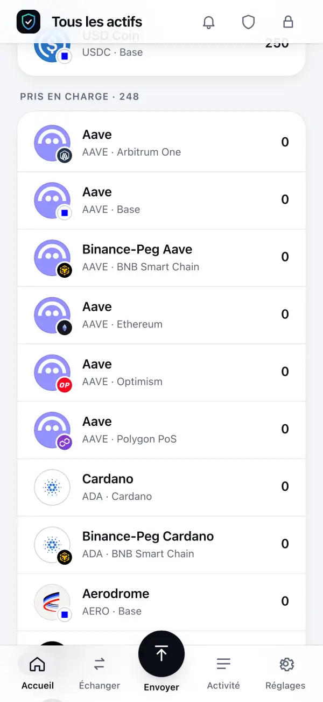 |  |

## What did not change, on purpose

- Review, confirmation and approval sheets show the same fields and values as before, in full. For the live and GMX
  sheets this was checked by dumping every text node of the 18 sheets before and after (digits and hashes masked) and
  comparing: identical. No acknowledgement, checkbox or typed word was removed; no step advances by itself.
- Fees, minimums, warnings, refusal reasons, risk notices and jurisdiction texts stay visible and verbatim. Only
  comparison-only swap routes are folded.
- SIMULATION / TESTNET — argent fictif / RÉEL — argent réel: same words, each with its own icon, pattern and fixed colours
  (white on the testnet and real bands ≥ 5.7 : 1, added to `apps/web/scripts/contrast.mjs`), still sticky, no close
  control, slightly larger than before.
- Nothing sent to the API changed. No amount in a sheet the owner approves is animated; the Futures terminal animates
  nothing in its hot path.

## Performance

Method as in the first pass: `tests/e2e/v9-perf.mts` (Chromium, 390 × 844 @3x, CPU ×4, a synthesised fling, the API
replayed from recorded answers) and Lighthouse 12 mobile (simulated slow 4G, CPU ×4) on the same replay server, three runs.
"Before" is the bundle as merged from the first pass and the hardening branch.

| | Before | After |
|---|---|---|
| First chunk (`index-*.js`) | 1 000.8 kB (gzip 293.9) | 257.3 kB (gzip 79.1) |
| JavaScript before the first screen, French | 1 000.8 kB (gzip 293.9) | 578 kB (gzip 179): index 257 + shared `ui` 64 + critical logos 17 + small shared chunks 22 + French texts 217 |
| CSS | 61.9 kB (gzip 12.5) | 86.3 kB (gzip 16.3) |
| Home — Lighthouse FCP / LCP (3 runs, identical) | 6.98 s / 9.5 s | 4.05 s / 6.0 s on the merged tree (3.83 s / 6.0 s right after the performance commit, before the five areas added shared code) |
| Home — scroll | 60.0 fps, 0 % frames > 20 ms | 60.0 fps, 0 % |
| Assets (251 rows) — scroll | 59.1 fps, 0.9 % frames > 20 ms, 0.6 % > 34 ms | 60.0 fps, 0 %, 0 % |
| Futures terminal, 20 updates / s (phone, CPU ×4) | 60 fps, frame p95 16.8 ms, 0 long task | 60.1 fps, p95 16.7 ms, 0 long task |

Causes found and fixed: both languages' texts (370 kB) and every screen were in the first chunk; the 320 kB logo set was
requested during the first paint; each of the ~500 logos of the asset list re-rendered once more when its image loaded;
the hero's buttons blurred an animated background on every frame. Now: one language at a time, one chunk per screen
(preloaded when the browser is idle), eight critical logos shipped with the app, logo plates that mark themselves loaded
without React state, no backdrop blur over the aurora.

## Not verified

A physical iPhone, Safari / WebKit, the installed PWA (splash, safe areas, keyboard lift, drag to dismiss on a real touch
screen), a real network. The numbers above are headless Chromium on a laptop: relative, not an iPhone's.

> Note (merge into main): only the phone, light-theme "after" pictures are kept in `main` (the full set — before/after, desktop, dark, about 95 MB — stays on branch `v10-integrate`, commit `211fbcc`). Links to other pictures on this page do not resolve here.
